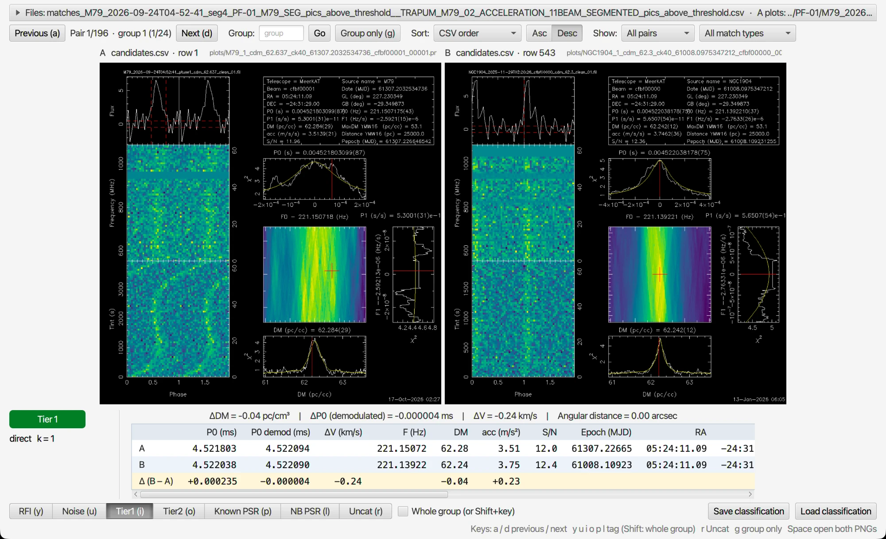

# CandyJar

CandyJar is a viewer for classifying pulsar search candidates, written for the TRAPUM and MPIfR surveys with MeerKAT and also used for Effelsberg data. It shows each candidate's diagnostic plot next to its parameters, a map of the beams with known pulsars nearby, and optional scatter plots of all candidates, and lets you tag candidates with the keyboard.

It also has a **match viewer** that shows candidates found in two searches side by side, to decide quickly whether they are the same pulsar. The matching itself is done by `csv_matcher_v2` from [rusty_candypicker](https://github.com/wintervolcano/rusty_candypicker), which is included and built along with CandyJar.

This repository is a fork of [vivekvenkris/CandyJar](https://github.com/vivekvenkris/CandyJar) (CandyJar V3.1 by Vivek Venkatraman Krishnan).

- [Requirements](#requirements)
- [Building and running](#building-and-running)
- [Classifying candidates](#classifying-candidates)
- [Comparing candidates across searches](#comparing-candidates-across-searches)
- [Command-line options](#command-line-options)
- [Troubleshooting](#troubleshooting)

## Requirements

- **Java 14 or 15** (a full JDK). JavaFX does not need to be installed: Gradle downloads it. The bundled Gradle (6.3) does not run on much newer JDKs.
  - macOS: download JDK 15 from https://jdk.java.net/archive/, unpack it into `/Library/Java/JavaVirtualMachines/`, and point `JAVA_HOME` at it, e.g. `export JAVA_HOME=$(/usr/libexec/java_home -v 15)` in your shell's rc file.
  - Linux: install OpenJDK 14 or 15 from your package manager or https://jdk.java.net/archive/, and select it with `update-alternatives --config java` if there are several.
  - Check with `java -version` and `javac -version`.
- **Rust** (`cargo`, from https://rustup.rs) to build the matcher for the match viewer. Optional: without it, everything else works.

## Building and running

```shell
git clone --recursive https://github.com/wintervolcano/CandyJar.git
cd CandyJar
./gradlew build
```

`--recursive` also fetches the `rusty_candypicker` submodule; if you forgot it, the build fetches the submodule itself. Each `./gradlew build` or `./gradlew run` also builds `csv_matcher_v2` with cargo, which takes a few seconds the first time and well under a second afterwards. Without cargo, the build prints a warning that automatic matching is not available and carries on.

Run CandyJar with

```shell
./gradlew run
```

and pass options with `--args`, for example `./gradlew run --args="-root_dir /path/to/results -s1 1"`. `./gradlew run --args="-h"` lists them all (see [Command-line options](#command-line-options)).

## Classifying candidates

### What CandyJar reads

CandyJar opens a **results directory** containing:

- `candidates.csv` (or another name given with `-csv`): one row per candidate. The header must contain `utc_start`, which is used to find the header and to group candidates by observation. Usual columns are `beam_name`, `ra`, `dec`, `mjd_start`, `f0_opt`, `dm_opt`, `acc_opt`, `sn_fold`, `png_path`, `metafile_path` and any `pics_*` classifier scores; columns that are missing are simply not shown.
- the plots, at the `png_path` of each row (relative to the results directory).
- the observation metafile at `metafile_path` (an APSUSE-style JSON file with the beam positions, beam shape and boresight), used for the beam map. Without a metafile, give the beam position with `-b` (see [Troubleshooting](#troubleshooting)).
- optionally `pulsars.list`: your own pulsars to mark on the beam map, one per line as `name ra dec p0 dm binary` (`binary` is `true` or `false`).

Known pulsars come from psrcat databases: the one in `$PSRCAT_DIR/psrcat.db` and any given with `-d`.

### Classifying

1. Choose the results directory with `...` (or type it, or give `-root_dir`) and press `Get`.
2. To continue an earlier session, press `Load classification` and choose the saved file.
3. Choose an observation (UTC). The beam map and the known pulsars nearby are shown.
4. Choose which candidate types to show and what to sort by, and press `Go`.
5. Step through the candidates and tag them with the keys below. With `-s2`, scatter plots of all candidates open on a second screen; hover over a plot's title for zoom, pan and marking tools.

| Key | Action |
|---|---|
| `a` / `d` | previous / next candidate |
| `y` `u` `i` `o` `p` `l` | tag as RFI, Noise, Tier 1, Tier 2, Known PSR, NB PSR (and move on) |
| `r` | reset to uncategorised |
| `Space` | open the plot in your default image viewer |
| `Ctrl+Space` | open the beam map image (when the metafile has one) |

The `Diagnostics` tab copies ready-made `prepfold`, `pulsarx` and `dspsr` commands for the current candidate to the clipboard.

`Save classification` writes `<file>.csv` (beam, UTC, plot and tag per candidate) and `<file>_full.csv` (every original column plus `classification`). CandyJar also autosaves to `<results dir name>_<user>_autosave.csv` in the results directory, every two minutes when tags have changed, so you can resume after a crash with `Load classification` (either the autosave or its `_full` file). When you open a directory whose autosave has tags, CandyJar says so. Before the first autosave of a session, the previous session's autosave is kept as `<results dir name>_<user>_autosave_previous.csv`. Delete these files when you are done.

## Comparing candidates across searches

The match viewer shows pairs of candidates from two searches (for example two observations of the same cluster) side by side, with the numbers that decide whether they are the same pulsar.



*The same 4.52 ms candidate in two MeerKAT observations of M79 taken ten months apart. The topocentric periods differ by 0.000235 ms, but the demodulated (barycentric) periods agree to 0.000004 ms (ΔV = −0.24 km/s), at the same position and DM.*

### Quick start

Give `-m` the candidate files of the two searches:

```shell
./gradlew run --args="-m /path/to/search_A/candidates.csv /path/to/search_B/candidates.csv"
```

CandyJar runs `csv_matcher_v2` in the background, writes the pairs to `matches_<A>__<B>.csv` next to the first file (A and B are the file names, or the directory names when both are called `candidates.csv`), and opens them. Plots are found next to the candidate file they came from.

The matcher's options default to `--ptol-frac 5e-4 --dmtol 2`. Give your own with `-margs`:

```shell
./gradlew run --args="-m A/candidates.csv B/candidates.csv -margs '--ptol-frac 1e-5 --dmtol 1 --bary --harmonics --hmax 4'"
```

| Matcher option | Meaning |
|---|---|
| `--ptol-frac` | fractional period tolerance, \|PA − PB\| / mean(PA, PB) |
| `--dmtol` | DM tolerance (pc/cm³); DM is not compared without it |
| `--acctol` | acceleration tolerance (m/s²); usually left out, since a binary's acceleration changes between observations |
| `--harmonics`, `--hmax k` | also match harmonics up to k |
| `--bary` | match on barycentric periods: Earth's motion is removed, so the tolerance can be much tighter (about 1e-6 for an isolated pulsar) |
| `--extra-cols a,b` | copy more candidate columns into the pairs |

See [`rusty_candypicker/README.md`](rusty_candypicker/README.md) for every option and every column of the pairs file. A good starting point for two observations months apart is `--ptol-frac 5e-4 --dmtol 2 --harmonics --hmax 4`, or `--ptol-frac 1e-5 --dmtol 2 --bary` when the candidate files have positions and epochs.

To open a pairs file made earlier, give `-m` that one file: `./gradlew run --args="-m matches.csv"`.

### Reading the screen

- **Plots**: candidate A on the left, B on the right, with their candidate file and row above them. Double-click to zoom in, scroll or drag to pan, right-click to reset; zoom and pan are linked between the two.
- **Summary line**: ΔDM, the change in the barycentric (demodulated) period ΔP0, the line-of-sight velocity change ΔV = c (PB − PA) / PA, and the angular distance between the two positions. A real pulsar keeps the same barycentric period across observations, so ΔP0 demodulated close to 0 is the strongest sign of a match; a binary pulsar can still differ by its orbital velocity.
- **Table**: the values of A and B for each parameter and their difference (B − A): P0, P0 demodulated, ΔV, frequency, DM, acceleration, S/N, Tobs, epoch, RA, DEC, separation and any PICS scores. Hover for full values; numbers can be selected and copied. Columns that are empty for every pair are hidden.
- **ΔV marked "topocentric"** (orange `topo`) means the candidate files had no position or epoch, so ΔV comes from topocentric periods and still contains the change in Earth's velocity (up to ~60 km/s between observations months apart).
- **Tag badge**: the current pair's tag, in colour, so you can see at a glance whether it is done.
- **Counter**: `Pair 12/340 · group 5 (2/3)` is the 12th of 340 pairs shown, and the 2nd of the 3 pairs of match group 5. A match group is a set of candidates linked by matches: if A1 matches B1 and B1 matches A5, all three are in one group.

### Navigating, sorting and filtering

- `Sort` by any numeric column of the pairs file, ascending or descending: `period_demod_frac_diff` (most pulsar-like first), `snr_a`, `pics_*`, `abs_dm_diff`, `ang_sep_arcsec`, `match_group` (keeps each group together), and so on.
- `Show` all pairs, only unclassified or only classified ones, or one category; the second menu filters by match type (direct or harmonic).
- `Group` jumps to a match group; `Group only` (`g`) shows every pair of the current group, whatever the filters.

### Tagging, saving and resuming

Tag with the same keys as the main viewer; the viewer moves on to the next pair. Hold `Shift` with a category key, or tick `Whole group`, to tag every pair of the current match group at once (including pairs hidden by the filters).

Every tag is saved immediately to `<pairs file>_classified.csv` next to the pairs file: the pairs file with an extra `classification` column. When the same pairs file is opened or re-made, the saved tags come back automatically. `Load classification` copies the tags from any saved file onto the open pairs, matching them by candidate file and row, so tags also carry over to a match re-run with other tolerances.

| Key | Action |
|---|---|
| `a` / `d` | previous / next pair |
| `y` `u` `i` `o` `p` `l` | tag as RFI, Noise, Tier 1, Tier 2, Known PSR, NB PSR (and move on) |
| `Shift` + tag key | tag the whole match group |
| `r` | reset to untagged |
| `g` | show only the current match group, or everything again |
| `Space` | open both plots in your default image viewer |

## Command-line options

```
 -a,--aspect_ratio <arg>              aspect ratio of the PNGs: PULSARX, PRESTO or a number. Default: 1.0
 -b,--boresight <arg>                 beam position when there is no metafile: name,RA(hh:mm:ss),DEC(dd:mm:ss),radius(deg)
 -csv <arg>                           candidate file in the results directory. Default: candidates.csv
 -d,--add_psrcat_db <arg>             add a psrcat database for known pulsars (positions in RA/DEC, hms/dms)
 -dmtol,--dm_tolerance <arg>          DM tolerance for grouping related candidates in an observation. Default: 5.0
 -e,--extend_png                      scale plots beyond their actual size (for high-resolution screens)
 -fh,--include_fractional_harmonics   also relate candidates at fractional harmonics
 -ftol,--freq_tolerance <arg>         period tolerance for grouping related candidates. Default: 1.0E-4
 -get_close_beams <arg>               compare two metafiles and list close beams in the second for each beam in the first
 -h,--help                            show this help
 -l,--list_screens                    list the available screens and exit
 -m,--match_csv <arg>...              open the match viewer: one pairs file, or two or more candidate files to match first
 -ma,--match_dir_a <arg>              directory for relative png_a paths in older pairs files. Default: the pairs file's directory
 -mb,--match_dir_b <arg>              the same for png_b
 -margs,--matcher_args <arg>          options for csv_matcher_v2, in quotes. Default: '--ptol-frac 5e-4 --dmtol 2'
 -matcher <arg>                       path of the csv_matcher_v2 binary. Default: the one built with CandyJar, else the PATH
 -n,--num_charts <arg>                number of scatter plots on the second screen (0 to 3)
 -p,--png_occupancy <arg>             fraction of the window width for the plot (0.25 to 0.75). Default: 0.5
 -r,--radius <arg>                    show known pulsars within this radius (deg) of the boresight. Default: 1.0
 -root_dir <arg>                      results directory to open at start
 -s1,--primary_screen <arg>           screen for the main window, optionally with a size: <screen>:<width>x<height>, e.g. 1:1920x1080
 -s2,--secondary_screen <arg>         screen for the scatter plots, same format
 -stol,--scale_tolerance              scale that period tolerance with the harmonic number
```

## Troubleshooting

**"Meta file is stale. Please provide boresight coordinates."** The candidates' metafile is missing. Give the beam with `-b`, using the candidates' `beam_name` as the name so each candidate is linked to the beam, e.g. `-b cfbf00003,15:17:24.404,-21:00:36.438,0.05`.

**Dates in another format.** `utc_start` is normally ISO (`2026-05-02T22:48:03`). For other formats such as `02-05-2026T22:48:03`, CandyJar takes the time from `mjd_start` instead (and prints a warning), since `02-05` could be 2 May or 5 February; without `mjd_start` the date is read as day-month-year. A metafile `utc_start` in an unknown format is ignored with a warning.

**"csv_matcher_v2 not found"** in the match viewer. The matcher was not built: install Rust from https://rustup.rs and run `./gradlew build` again, or point `-matcher` at a `csv_matcher_v2` binary.

**"PNG not found"** in the match viewer. The plot is not where the pairs file says. For pairs files made by an older matcher (without `path_a`/`path_b`), give the directories the plots are relative to with `-ma` and `-mb`.

**Gradle fails on start with an unsupported Java version.** Use Java 14 or 15 (see [Requirements](#requirements)).
